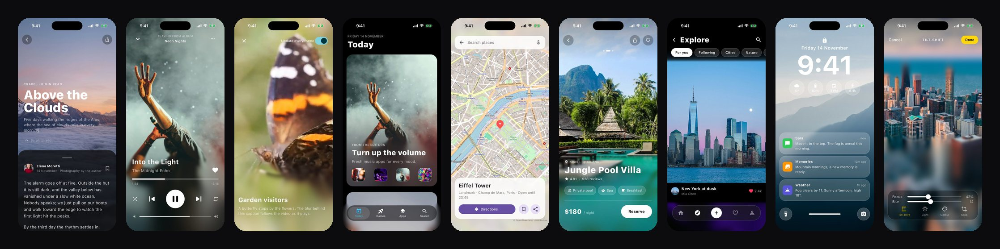
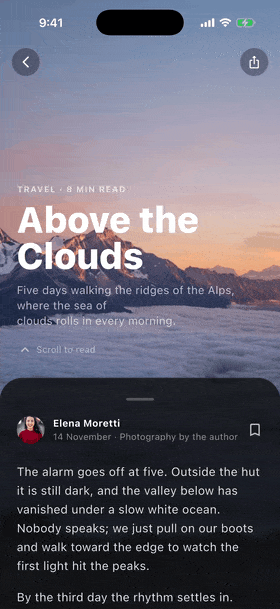
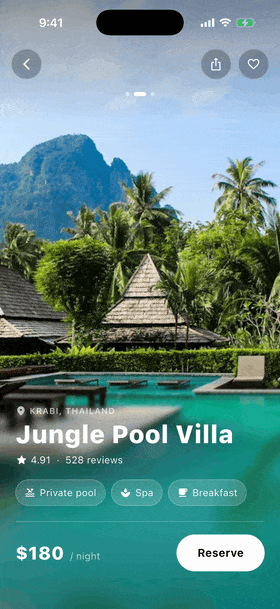
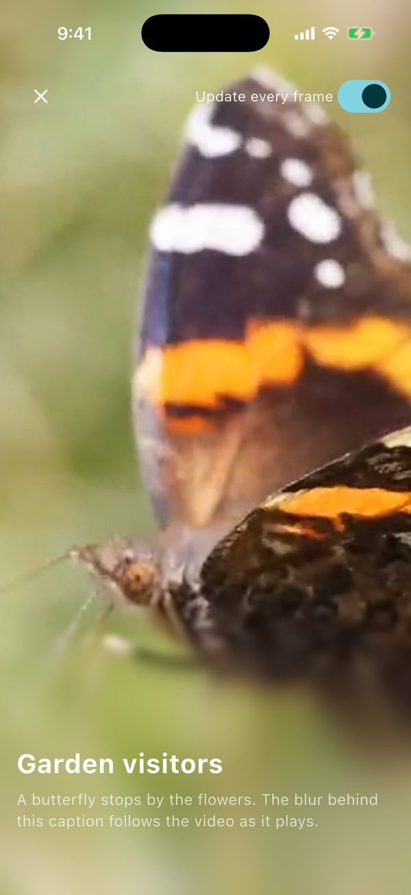
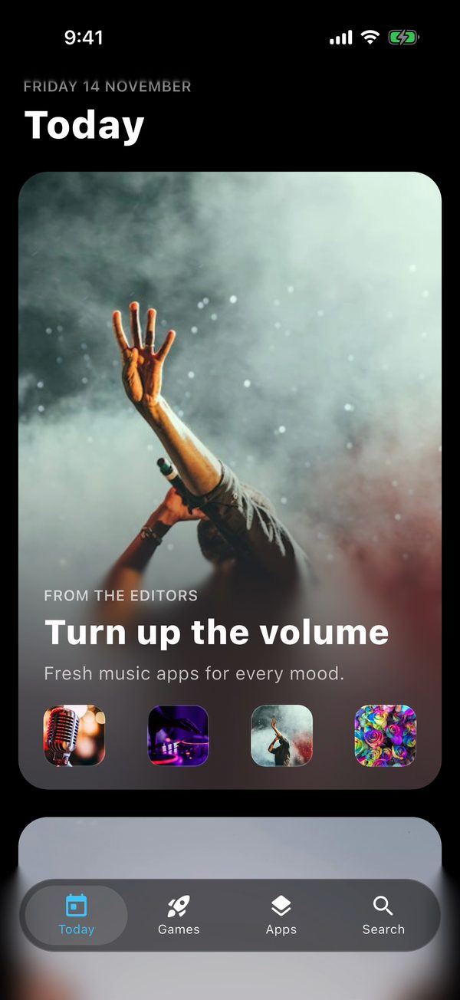
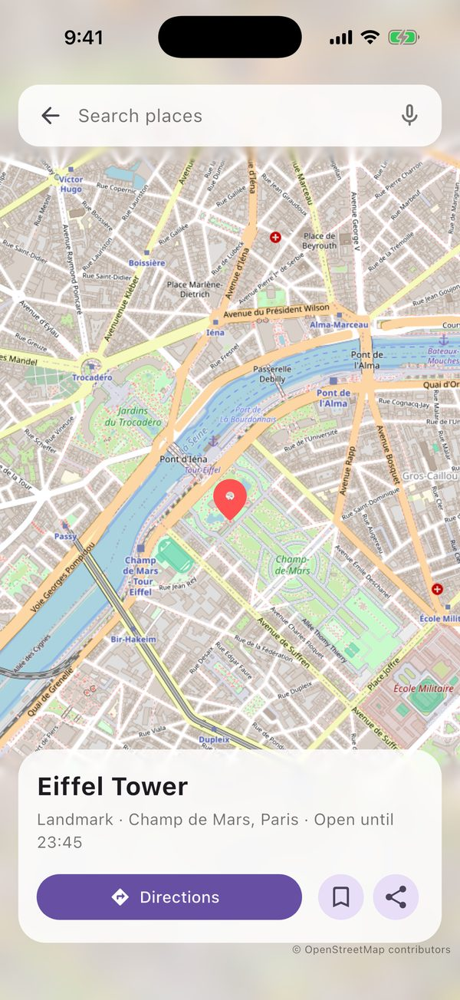
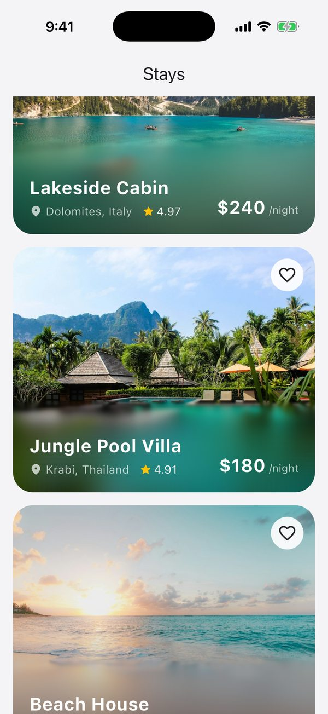
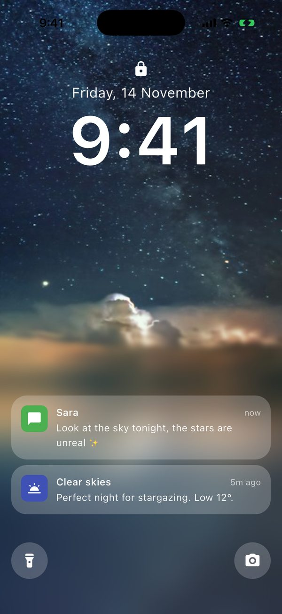
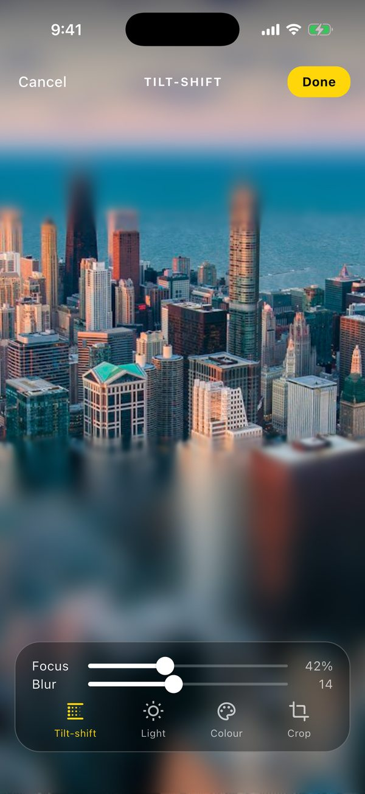

# Variable Blur

[](https://pub.dev/packages/variable_blur)
[](https://pub.dev/packages/variable_blur/score)
[](https://pub.dev/packages/variable_blur)
[](LICENSE)

**Progressive blur for Flutter.** Fade any widget from sharp to blurred, the way
modern iOS apps do under their headers, tab bars, photos and players.



<p align="center">
  
  
  
</p>

## Why Variable Blur

- **True progressive blur.** Every pixel gets its own blur strength, rising
  smoothly from sharp to full blur. Not a sharp image faded over a blurred one.
- **The sharp part stays pixel-perfect.** Only the blurred edges are redrawn.
- **Light.** Blurs a small copy of only the edges that need it, like Flutter's own
  blur, and reuses the result while the widget scrolls.
- **Works on video and live content.** Turn on `updateEveryFrame` and the blur
  follows a playing video or camera preview.
- **One widget.** Wrap a widget, pick the sides, done. No setup, no native code.

## Quick start

**1. Add it**

```yaml
dependencies:
  variable_blur: ^0.2.0
```

**2. Wrap a widget**

```dart
import 'package:variable_blur/variable_blur.dart';

VariableBlur(
  sigma: 20,                                        // how strong the blur gets
  blurSides: const BlurSides.vertical(bottom: 0.4), // the bottom 40% blurs
  child: Image.network(photoUrl, fit: BoxFit.cover),
)
```

The top 60% stays sharp, then the photo fades smoothly into blur. That one
widget is behind every design on this page.

**3. Put your content on top**

Most designs stack text or controls over the blurred part:

```dart
Stack(
  fit: StackFit.expand,
  children: [
    VariableBlur(
      sigma: 20,
      blurSides: const BlurSides.vertical(bottom: 0.4),
      child: Image.network(photoUrl, fit: BoxFit.cover),
    ),
    const Positioned(left: 24, right: 24, bottom: 32, child: Text('Hello')),
  ],
)
```

---

## The gallery

Nine real screens, each built around one `VariableBlur`. Tap a name to jump to
its code. All of them are in the [example app](example/lib/screens/showcase/).

| | | |
| :---: | :---: | :---: |
| [](#scroll-story) | [](#music-player) | [](#video-story) |
| [**Scroll story**](#scroll-story)<br>Blur that grows as you read | [**Music player**](#music-player)<br>Album art into the controls | [**Video story**](#video-story)<br>Blur that follows a video |
| [](#story-cards) | [](#map) | [](#travel-stays) |
| [**Story cards**](#story-cards)<br>Photos melting into their colour | [**Map**](#map)<br>A map fading behind its panels | [**Travel stays**](#travel-stays)<br>Text that reads on any photo |
| [](#frosted-header-and-tab-bar) | [](#lock-screen) | [](#miniature-city-tilt-shift) |
| [**Frosted bars**](#frosted-header-and-tab-bar)<br>A feed under header and tabs | [**Lock screen**](#lock-screen)<br>Mist behind notifications | [**Miniature city**](#miniature-city-tilt-shift)<br>Tilt-shift toy-model look |

---

## How each one is made

### Scroll story

A magazine article slides up over its cover photo. The photo blurs more, and
higher up, the further you read. Drive `sigma` and `blurSides` from the scroll
position.


```dart
// progress goes from 0 at the top to 1 once the article covers the photo.
final progress = (controller.offset / 400).clamp(0.0, 1.0);

Stack(
  children: [
    Positioned.fill(
      child: VariableBlur(
        sigma: 6 + 26 * progress,
        edgeIntensity: 0.3,
        blurSides: BlurSides.vertical(
          top: 0.12 * progress,
          bottom: 0.35 + 0.65 * progress,
        ),
        child: Image.network(cover, fit: BoxFit.cover),
      ),
    ),
    CustomScrollView(controller: controller, slivers: [spacer, article]),
  ],
)
```

### Music player

The album art melts into the player controls.


```dart
VariableBlur(
  sigma: 30,
  edgeIntensity: 0.5,
  blurSides: const BlurSides.vertical(bottom: 0.45),
  child: Image.network(albumArt, fit: BoxFit.cover),
)
```

### Video story

A playing video with blur behind the caption. Video frames reach the screen
without Flutter repainting anything, so tell the blur to follow every frame.


```dart
VariableBlur(
  sigma: 24,
  edgeIntensity: 0.25,
  blurSides: const BlurSides.vertical(top: 0.12, bottom: 0.35),
  updateEveryFrame: true, // keep the blur in step with the video
  child: VideoPlayer(controller),
)
```

### Story cards

Cards whose photos melt into a blur tinted with their own colour. The page also
blurs under the status bar and the floating tab bar.


```dart
Stack(
  fit: StackFit.expand,
  children: [
    VariableBlur(
      sigma: 28,
      edgeIntensity: 0.3,
      blurSides: const ResponsiveBlurSides.vertical(bottom: 220),
      child: Image.network(photo, fit: BoxFit.cover),
    ),
    // Fade into the photo's own colour.
    DecoratedBox(
      decoration: BoxDecoration(
        gradient: LinearGradient(
          begin: Alignment.topCenter,
          end: Alignment.bottomCenter,
          stops: const [0.4, 0.85],
          colors: [tint.withValues(alpha: 0), tint.withValues(alpha: 0.75)],
        ),
      ),
    ),
    // Title, subtitle and app icons on top.
  ],
)
```

### Map

The map fades into blur behind the search bar and the place card. Works with
map packages drawn by Flutter, such as
[`flutter_map`](https://pub.dev/packages/flutter_map).


```dart
VariableBlur(
  sigma: 14,
  edgeIntensity: 0.08,
  blurSides: ResponsiveBlurSides.vertical(
    top: padding.top + 90,
    bottom: padding.bottom + 190,
  ),
  child: FlutterMap(options: mapOptions, children: [tileLayer, markers]),
)
```

### Travel stays

Full-screen stays you swipe between. The details read on any photo, without a
heavy dark gradient.


```dart
PageView.builder(
  itemCount: stays.length,
  itemBuilder: (context, i) => Stack(
    fit: StackFit.expand,
    children: [
      VariableBlur(
        sigma: 26,
        edgeIntensity: 0.35,
        blurSides: const BlurSides.vertical(bottom: 0.4),
        child: Image.network(stays[i].photo, fit: BoxFit.cover),
      ),
      Positioned(left: 22, right: 22, bottom: 20, child: details),
    ],
  ),
)
```

### Frosted header and tab bar

Blur the page, not the bars: the photos fade into blur as they slide under the
header and the floating tab bar, which stay crisp on top.


```dart
final padding = MediaQuery.paddingOf(context);

Stack(
  children: [
    VariableBlur(
      sigma: 18,
      edgeIntensity: 0.07,
      blurSides: ResponsiveBlurSides.vertical(
        top: padding.top + 136,       // header height + fade
        bottom: padding.bottom + 104, // tab bar height + fade
      ),
      child: ListView(children: posts),
    ),
    Positioned(top: 0, left: 0, right: 0, child: header),
    Positioned(left: 20, right: 20, bottom: 10, child: floatingTabBar),
  ],
)
```

### Lock screen

Sharp mountains behind the clock, soft mist behind the notifications.


```dart
VariableBlur(
  sigma: 26,
  edgeIntensity: 0.25,
  blurSides: const BlurSides.vertical(bottom: 0.55),
  child: Image.network(wallpaper, fit: BoxFit.cover),
)
```

### Miniature city (tilt-shift)

Blur above and below a sharp band and a real city looks like a tiny model.
Sliders move the band and change the blur live.


```dart
const band = 0.22; // height of the sharp band
VariableBlur(
  sigma: sigma,    // from the Blur slider
  edgeIntensity: 0.12,
  blurSides: BlurSides.vertical(
    top: focus - band / 2,        // focus comes from the Focus slider
    bottom: 1 - focus - band / 2,
  ),
  child: Image.network(aerialPhoto, fit: BoxFit.cover),
)
```

---

## The three settings that matter

**`sigma`: how strong the blur gets.** Around 10 is soft, 20 to 30 is heavy.

**`blurSides`: which edges blur, and how far in.** As a fraction of the child's
size, or in logical pixels:

```dart
// Fractions of the child's size (0.0 to 1.0): scale with the widget.
BlurSides.vertical(top: 0.2, bottom: 0.4)
BlurSides.horizontal(left: 0.3, right: 0.3)

// Logical pixels: fixed distances, ideal for headers and bars.
ResponsiveBlurSides.vertical(top: 120, bottom: 90)
ResponsiveBlurSides.horizontal(left: 40, right: 40)
```

**`edgeIntensity`: how gradual the fade is.** A fraction of the child's longer
side. Small values (0.05) give a short, quick fade; larger ones (0.3 to 0.5) a
long, soft one.

## API

### `VariableBlur`

| Parameter            | Type            | Default            | What it does                                                        |
| -------------------- | --------------- | ------------------ | ------------------------------------------------------------------- |
| `child`              | `Widget`        | required           | The widget to blur.                                                 |
| `sigma`              | `double`        | required           | The strongest blur, in logical pixels. `0` shows the child as is.   |
| `blurSides`          | `BlurSidesBase` | required           | Which sides blur and how far: `BlurSides` or `ResponsiveBlurSides`. |
| `edgeIntensity`      | `double`        | `0.15`             | How gradually the blur rises (0.0 to 1.0).                          |
| `quality`            | `BlurQuality`   | `BlurQuality.high` | Trades smoothness for speed and memory.                             |
| `updateEveryFrame`   | `bool`          | `false`            | Redo the blur every frame, for video, camera and other textures.    |
| `useRepaintBoundary` | `bool`          | `true`             | Wraps the blur in a `RepaintBoundary`.                              |
| `isYFlipNeed`        | `bool`          | `false`            | Deprecated, no longer needed.                                       |

### `BlurQuality`

| Value    | Blurred copy     | Samples per side | Use for                      |
| -------- | ---------------- | ---------------- | ---------------------------- |
| `low`    | down to 1/8 size | 16               | Lists of many blurred items. |
| `medium` | down to 1/8 size | 24               | A balance of both.           |
| `high`   | down to 1/4 size | 32               | Hero images, players.        |

## What it can blur

| Content                                               | Works? | Notes                                                                                                                                          |
| ----------------------------------------------------- | ------ | ---------------------------------------------------------------------------------------------------------------------------------------------- |
| Images, text, lists, any Flutter widget               | Yes    | Re-blurred automatically when the content changes.                                                                                             |
| Scrolling content                                     | Yes    | Moving the widget reuses the last blur.                                                                                                        |
| Video, camera preview, other `Texture` widgets        | Yes    | Set `updateEveryFrame: true`, or the blurred part freezes.                                                                                     |
| Maps drawn by Flutter (`flutter_map`)                 | Yes    |                                                                                                                                                |
| Native views: Google Maps, Apple Maps, `WebView`, ads | No     | Drawn by iOS or Android, not by Flutter, so Flutter cannot read their pixels. This is true of every Flutter blur package that blurs its child. |

`VariableBlur` blurs **its child**, not what is behind it. To blur content
under a bar, wrap the content and stack the bar on top (see
[Frosted header and tab bar](#frosted-header-and-tab-bar)).

## Performance

Measured on an **iPhone 7 Plus** (release mode), a full-screen list scrolling
under a 200 pt blurred top band:

|                | Extra memory | Frame time |
| -------------- | ------------ | ---------- |
| No blur        | 0            | 3.8 ms     |
| `VariableBlur` | about 11 MB  | 3.7 ms     |

All runs held 60 fps. Tips:

1. Call `VariableBlur.precacheShaders()` at startup so the first blurred frame is
   not delayed:

   ```dart
   void main() async {
     WidgetsFlutterBinding.ensureInitialized();
     await VariableBlur.precacheShaders();
     runApp(const MyApp());
   }
   ```

2. Blur only what needs it: only the blurred sides are processed, so a short top
   fade costs much less than blurring a whole screen.
3. Use `BlurQuality.low` for lists with many blurred items.
4. Leave `updateEveryFrame` off unless the child shows a video or other texture.

## Try the example app

```bash
cd example
flutter run
```

The home screen opens every design. To open one directly:

```bash
flutter run --dart-define=SHOWCASE=scroll
# also: music, video, stories, map, travel, feed, lock, miniature
```

## Troubleshooting

**No blur visible?** The child needs visible pixels (a colour, image or text),
and both `sigma` and at least one side must be above zero.

**Blurred part of a video is frozen?** Set `updateEveryFrame: true`.

**Native map or web view not blurred?** Native views cannot be read by Flutter.
Use a Flutter-drawn alternative such as `flutter_map`.

**Upside-down blur?** Should not happen any more on any backend. If you see it,
please [open an issue](https://github.com/ibrahimbnc/variable_blur/issues).

## License

MIT. Photos in the example app and on this page are from [Unsplash](https://unsplash.com);
map data © [OpenStreetMap](https://www.openstreetmap.org/copyright) contributors.
