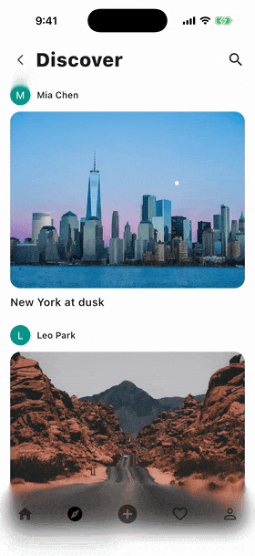
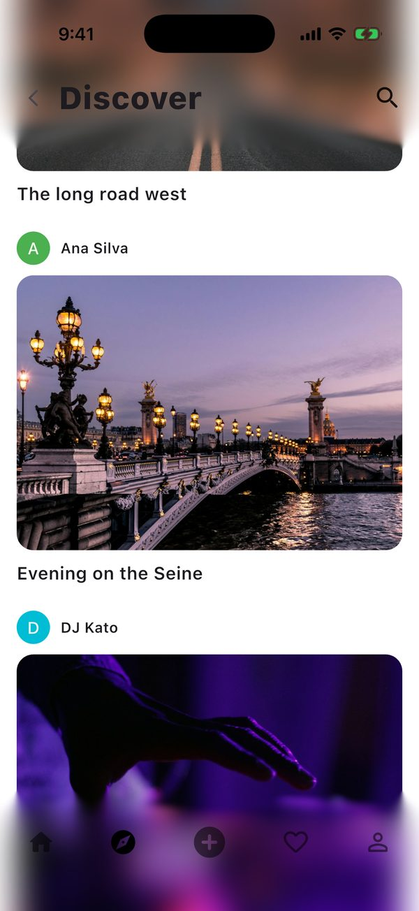
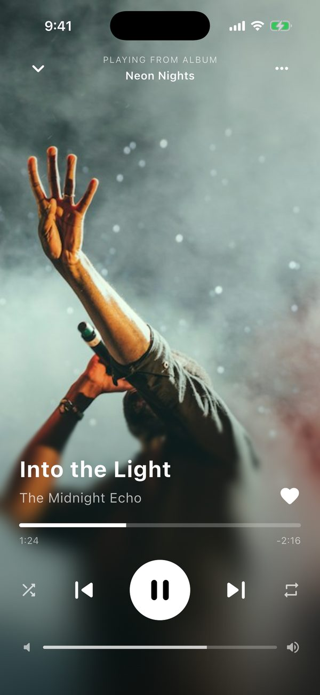

# Variable Blur

[](https://pub.dev/packages/variable_blur)
[](https://pub.dev/packages/variable_blur/score)
[](LICENSE)

**Progressive blur for Flutter.** Fade any widget from sharp to blurred, the way
modern iOS apps do under their headers, tab bars, photos and players.

<p align="center">
  
  
  
</p>

- **True progressive blur.** Every pixel gets its own blur strength, rising
  smoothly from sharp to full blur. Not a sharp image faded over a blurred one.
- **The sharp part stays pixel-perfect.** Only the blurred edges are redrawn.
- **Light.** Blurs a small copy of only the edges that need it, like Flutter's own
  blur, and reuses the result while the widget scrolls.
- **Works on video too.** Turn on `updateEveryFrame` and the blur follows a
  playing video or camera preview.
- **One widget, one line.** Wrap a widget, pick the sides, done.

## Quick start

```yaml
dependencies:
  variable_blur: ^0.2.0
```

```dart
import 'package:variable_blur/variable_blur.dart';

VariableBlur(
  sigma: 20,                                        // strongest blur
  blurSides: const BlurSides.vertical(bottom: 0.4), // bottom 40% blurs
  child: Image.network(photoUrl, fit: BoxFit.cover),
)
```

That's it. Everything below is built from that one widget. Every showcase is in
the [example app](example/lib/screens/showcase/).

---

## Showcase

### Story cards

Photos that melt into blur, tinted with their own colour. The page also blurs
under the status bar and the floating tab bar.


```dart
Stack(
  fit: StackFit.expand,
  children: [
    VariableBlur(
      sigma: 28,
      edgeIntensity: 0.25,
      blurSides: const BlurSides.vertical(bottom: 0.5),
      child: Image.network(photo, fit: BoxFit.cover),
    ),
    // Fade into the photo's own colour.
    DecoratedBox(
      decoration: BoxDecoration(
        gradient: LinearGradient(
          begin: Alignment.topCenter,
          end: Alignment.bottomCenter,
          stops: const [0.4, 0.85],
          colors: [tint.withValues(alpha: 0), tint.withValues(alpha: 0.75)],
        ),
      ),
    ),
    // Title, subtitle and app row on top.
  ],
)
```

### Frosted header and tab bar

Blur the page, not the bars: the content fades into blur as it slides under the
header and the tab bar, which stay crisp on top.



```dart
final padding = MediaQuery.paddingOf(context);

Stack(
  children: [
    VariableBlur(
      sigma: 16,
      edgeIntensity: 0.06,
      blurSides: ResponsiveBlurSides.vertical(
        top: padding.top + 88,       // header height + fade
        bottom: padding.bottom + 88, // tab bar height + fade
      ),
      child: ListView(children: posts),
    ),
    Positioned(top: 0, left: 0, right: 0, child: header),
    Positioned(bottom: 0, left: 0, right: 0, child: tabBar),
  ],
)
```

### Music player

The album art melts into the controls.



```dart
VariableBlur(
  sigma: 30,
  edgeIntensity: 0.3,
  blurSides: const BlurSides.vertical(bottom: 0.55),
  child: Image.network(albumArt, fit: BoxFit.cover),
)
```

### Travel cards

Text that reads on any photo, without a heavy dark gradient.


```dart
ClipRRect(
  borderRadius: BorderRadius.circular(24),
  child: Stack(
    fit: StackFit.expand,
    children: [
      VariableBlur(
        sigma: 22,
        edgeIntensity: 0.2,
        blurSides: const BlurSides.vertical(bottom: 0.4),
        child: Image.network(photo, fit: BoxFit.cover),
      ),
      Positioned(left: 20, right: 20, bottom: 18, child: titleAndPrice),
    ],
  ),
)
```

### Lock screen

A sharp sky behind the clock, a soft one behind the notifications.


```dart
VariableBlur(
  sigma: 24,
  edgeIntensity: 0.25,
  blurSides: const BlurSides.vertical(bottom: 0.5),
  child: Image.network(wallpaper, fit: BoxFit.cover),
)
```

### Miniature city (tilt-shift)

Blur the top and bottom of an aerial photo and a real city looks like a tiny model.


```dart
VariableBlur(
  sigma: 14,
  edgeIntensity: 0.18,
  blurSides: const BlurSides.vertical(top: 0.38, bottom: 0.38),
  child: Image.network(aerialPhoto, fit: BoxFit.cover),
)
```

### Map

The map fades into blur behind the search bar and the place card. Works with
map packages drawn by Flutter, such as
[`flutter_map`](https://pub.dev/packages/flutter_map).


```dart
VariableBlur(
  sigma: 14,
  edgeIntensity: 0.08,
  blurSides: ResponsiveBlurSides.vertical(
    top: padding.top + 90,
    bottom: padding.bottom + 190,
  ),
  child: FlutterMap(options: mapOptions, children: [tileLayer, markers]),
)
```

### Video

A playing video with blur behind the caption. Video frames reach the screen
without Flutter repainting anything, so tell the blur to follow every frame.


```dart
VariableBlur(
  sigma: 24,
  blurSides: const BlurSides.vertical(top: 0.12, bottom: 0.4),
  updateEveryFrame: true, // keep the blur in step with the video
  child: VideoPlayer(controller),
)
```

---

## Blur regions

Pick how far each side blurs, as a fraction of the child's size or in logical
pixels.

```dart
// Fractions of the child's size (0.0 to 1.0): scale with the widget.
BlurSides.vertical(top: 0.2, bottom: 0.4)
BlurSides.horizontal(left: 0.3, right: 0.3)

// Logical pixels: fixed distances, ideal for headers and bars.
ResponsiveBlurSides.vertical(top: 120, bottom: 90)
ResponsiveBlurSides.horizontal(left: 40, right: 40)
```

`edgeIntensity` sets how gradually the blur rises, as a fraction of the child's
longer side: small values give a quick, short fade, larger ones a long, soft one.

## API

### `VariableBlur`

| Parameter            | Type            | Default            | What it does                                                        |
| -------------------- | --------------- | ------------------ | ------------------------------------------------------------------- |
| `child`              | `Widget`        | required           | The widget to blur.                                                 |
| `sigma`              | `double`        | required           | The strongest blur, in logical pixels. `0` shows the child as is.   |
| `blurSides`          | `BlurSidesBase` | required           | Which sides blur and how far: `BlurSides` or `ResponsiveBlurSides`. |
| `edgeIntensity`      | `double`        | `0.15`             | How gradually the blur rises (0.0 to 1.0).                          |
| `quality`            | `BlurQuality`   | `BlurQuality.high` | Trades smoothness for speed and memory.                             |
| `updateEveryFrame`   | `bool`          | `false`            | Redo the blur every frame, for video, camera and other textures.    |
| `useRepaintBoundary` | `bool`          | `true`             | Wraps the blur in a `RepaintBoundary`.                              |
| `isYFlipNeed`        | `bool`          | `false`            | Deprecated, no longer needed.                                       |

### `BlurQuality`

| Value    | Blurred copy     | Samples per side | Use for                      |
| -------- | ---------------- | ---------------- | ---------------------------- |
| `low`    | down to 1/8 size | 16               | Lists of many blurred items. |
| `medium` | down to 1/8 size | 24               | A balance of both.           |
| `high`   | down to 1/4 size | 32               | Hero images, players.        |

## What it can blur

| Content                                               | Works? | Notes                                                                                                                                          |
| ----------------------------------------------------- | ------ | ---------------------------------------------------------------------------------------------------------------------------------------------- |
| Images, text, lists, any Flutter widget               | Yes    | Re-blurred automatically when the content changes.                                                                                             |
| Scrolling content                                     | Yes    | Moving the widget reuses the last blur.                                                                                                        |
| Video, camera preview, other `Texture` widgets        | Yes    | Set `updateEveryFrame: true`, or the blurred part freezes.                                                                                     |
| Maps drawn by Flutter (`flutter_map`)                 | Yes    |                                                                                                                                                |
| Native views: Google Maps, Apple Maps, `WebView`, ads | No     | Drawn by iOS or Android, not by Flutter, so Flutter cannot read their pixels. This is true of every Flutter blur package that blurs its child. |

`VariableBlur` blurs **its child**, not what is behind it. To blur content
under a bar, wrap the content and stack the bar on top (see
[Frosted header and tab bar](#frosted-header-and-tab-bar)).

## Performance

Measured on an **iPhone 7 Plus** (release mode), a full-screen list scrolling
under a 200 pt blurred top band:

|                | Extra memory | Frame time |
| -------------- | ------------ | ---------- |
| No blur        | 0            | 3.8 ms     |
| `VariableBlur` | about 11 MB  | 3.7 ms     |

All runs held 60 fps. Tips:

1. Call `VariableBlur.precacheShaders()` at startup so the first blurred frame is
   not delayed:

   ```dart
   void main() async {
     WidgetsFlutterBinding.ensureInitialized();
     await VariableBlur.precacheShaders();
     runApp(const MyApp());
   }
   ```

2. Blur only what needs it: only the blurred sides are processed, so a short top
   fade costs much less than blurring a whole screen.
3. Use `BlurQuality.low` for lists with many blurred items.
4. Leave `updateEveryFrame` off unless the child shows a video or other texture.

## Example app

```bash
cd example
flutter run
```

The home screen opens every showcase. To open one directly:

```bash
flutter run --dart-define=SHOWCASE=stories   # also: feed, music, travel, lock, miniature, map, video
```

## Troubleshooting

**No blur visible?** The child needs visible pixels (a colour, image or text),
and both `sigma` and at least one side must be above zero.

**Blurred part of a video is frozen?** Set `updateEveryFrame: true`.

**Native map or web view not blurred?** Native views cannot be read by Flutter.
Use a Flutter-drawn alternative such as `flutter_map`.

**Upside-down blur?** Should not happen any more on any backend. If you see it,
please [open an issue](https://github.com/ibrahimbnc/variable_blur/issues).

## License

MIT. Photos in the example app and on this page are from [Unsplash](https://unsplash.com);
map data © [OpenStreetMap](https://www.openstreetmap.org/copyright) contributors.
